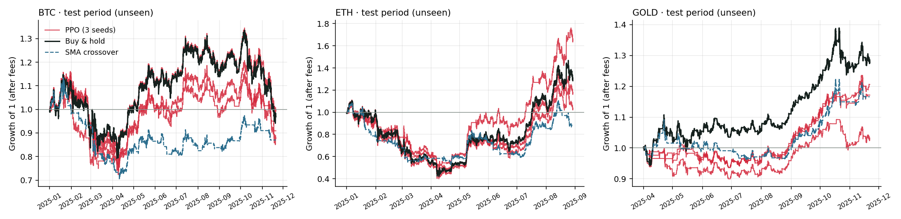
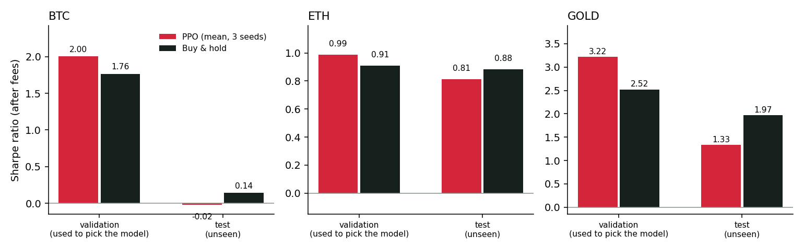

# RL Trading Agent — PPO vs. buy & hold, tested honestly

**Python · Stable-Baselines3 (PPO) · Gymnasium · pandas · hourly BTC, ETH and gold data**

Can a reinforcement-learning agent learn when to be in the market and when to sit in cash, well enough to beat simply
holding the asset once fees are paid? This project trains PPO agents on hourly data and evaluates them on a period they
never saw, against simple baselines, with the safeguards a real backtest needs.

**Short answer: no.** On the 2025 test period, the PPO agents (averaged over three training seeds) do not beat buy &
hold on any of the three assets, even though they all beat it on the validation year used to select them. This README
shows how that happens and why it is the expected outcome, not a bug.



## Results on the test period (unseen, used once)

| Test period | Strategy | Return | Sharpe | Max drawdown | Trades | Time invested |
|---|---|---:|---:|---:|---:|---:|
| **BTC** · Jan–Nov 2025 | PPO, mean of 3 seeds | −7.4 % | −0.02 | −34.5 % | 31 | 91 % |
| | Buy & hold | −3.1 % | 0.14 | −31.0 % | 1 | 100 % |
| | SMA crossover 24 h / 7 d | −13.0 % | −0.37 | −37.9 % | 76 | 53 % |
| | Random, same turnover | −5.8 % | −0.03 | −28.1 % | 30 | 57 % |
| **ETH** · Jan–Aug 2025 | PPO, mean of 3 seeds | +27.2 % | 0.81 | −59.1 % | 42 | 90 % |
| | Buy & hold | +28.5 % | 0.88 | −61.9 % | 1 | 100 % |
| | SMA crossover 24 h / 7 d | −11.7 % | −0.13 | −51.5 % | 66 | 53 % |
| | Random, same turnover | +30.4 % | 1.01 | −44.5 % | 39 | 59 % |
| **Gold** · Apr–Nov 2025 | PPO, mean of 3 seeds | +13.7 % | 1.33 | −8.4 % | 112 | 70 % |
| | Buy & hold | +28.5 % | 1.97 | −11.0 % | 1 | 100 % |
| | SMA crossover 24 h / 7 d | +16.6 % | 1.63 | −12.1 % | 30 | 58 % |
| | Random, same turnover | +6.0 % | 0.74 | −8.0 % | 107 | 44 % |

All figures after fees. Per-seed results and validation-year tables: `results/*.md`.



## What the results say

1. **The validation edge does not survive.** On the validation year the agents beat buy & hold on every asset
   (Sharpe 2.00 vs 1.76 on BTC, 3.22 vs 2.52 on gold). On the test period they fall behind. Each agent is the best
   of 20 checkpoints on a single validation year, so part of that edge is the noise of that particular year: picking
   the maximum of many noisy scores is optimistic by construction (selection bias). Only the test period measures
   real performance.
2. **What the agents mostly learned is to stay invested.** They spend about 90 % of the time in the market on BTC and
   ETH. The training years (2020–2023) contain a long bull run, and with 0.1 % fees per trade, holding is a strong
   default. Their gap to buy & hold comes entirely from the hours they spend in cash and from fees. On gold, the agent exits after the sharp sell-off
   of early April 2025 and misses the rebound (`figures/GOLD_positions_test.png`).
3. **No evidence of timing skill.** Results vary widely between seeds (ETH: +2 % to +63 % on the same test period),
   and a random strategy with the same number of trades lands within the agents' range on all three assets. A
   single-seed result would have been misleading in either direction.
4. **Some risk reduction, at a cost.** On gold the agents cut volatility (16 % vs 21 %) and drawdown (−8.4 % vs
   −11.0 %), but they give up more return than they save in risk, so the Sharpe ratio is lower.

The test period was evaluated once, after all training and model-selection choices were frozen; no parameter was
changed after seeing it.

## Next steps

- **Walk-forward evaluation**: retrain every quarter on a rolling window and chain the out-of-sample quarters, to get
  many test periods instead of one.
- **Less optimistic model selection**: average the last checkpoints or ensemble the seeds instead of keeping the
  single best validation score.
- **Features that carry information beyond past prices**, such as funding rates, order-book imbalance or cross-asset
  signals. With price-only inputs, beating buy & hold after fees is a hard problem.
- **A significance test** (block bootstrap of the Sharpe difference) before claiming any edge.

## Setup

| | |
|---|---|
| **Data** | Hourly OHLCV: BTC/USD and ETH/USD (Binance, from Aug. 2020), gold (Yahoo Finance, from Nov. 2023) |
| **Split** | Train → validation (model selection) → test, strictly chronological. BTC/ETH: train to end-2023, validate on 2024, test on 2025. Gold: train to Sep. 2024, validate to Mar. 2025, test to Nov. 2025 |
| **Actions** | Every hour: fully in cash (0) or fully invested (1). Long/flat only, no leverage, no shorting |
| **Fees** | 0.10 % per trade on crypto (Binance spot taker fee), 0.05 % on gold, charged on every switch |
| **Observation** | 12 features computed from the past only (returns over 1 h, 4 h, 24 h, 7 days; 24 h and 7-day volatility; RSI; distance to 24 h and 7-day moving averages; volume z-score; hour of day) + current position |
| **Reward** | Hourly log growth of the portfolio after fees. Summed over an episode it equals log(final wealth), so the agent optimises wealth with fees and compounding included |
| **Training** | PPO, MLP 64×64, 1M steps, 8 parallel environments sampling random 30-day windows; 3 seeds per asset |
| **Model selection** | Every 50k steps the policy is run over the full validation period; the checkpoint with the best validation Sharpe ratio is kept. The test period is used once, at the end |

## Safeguards against a misleading backtest

- **No look-ahead.** Every feature at hour *t* uses prices up to the close of *t*; the position chosen at *t* earns
  the return from *t* to *t*+1. A test recomputes features on a truncated series and checks they are identical.
- **Scaling fitted on the training period only.** An earlier version of this project normalised prices with the mean
  and standard deviation of the *whole* series, which quietly leaks the future into the inputs. Here, mean and
  standard deviation come from the training period and are applied unchanged to validation and test.
- **Fees on every trade**, so a strategy that trades hourly pays for it.
- **Several seeds.** RL results vary a lot between runs; reporting one lucky seed would be cherry-picking.
- **A random baseline with the same turnover** as the agents, to check whether the agent's timing adds anything over
  chance.
- **Environment and backtest cross-checked**: an always-invested agent reproduces buy & hold to 1e-9.

## Run it

```bash
pip install -r requirements.txt
python -m pytest                                        # leakage and accounting tests
python -m rltrade.train --asset BTC --steps 1000000     # ~5 min per seed on a laptop CPU
python -m rltrade.train --asset ETH --steps 1000000
python -m rltrade.train --asset GOLD --steps 1000000
python -m rltrade.evaluate                              # tables in results/, charts in figures/
```

## Project layout

```
rltrade/features.py   causal features, chronological split, train-only scaling
rltrade/env.py        Gymnasium environment: long/flat, fees, log-growth reward
rltrade/backtest.py   equity curves, metrics, reference strategies, agent roll-out
rltrade/train.py      PPO training with validation-based checkpoint selection
rltrade/evaluate.py   final test-period evaluation, tables and figures
tests/                look-ahead, scaling, fee and environment checks
```

## Resumen en español

Agentes de aprendizaje por refuerzo (PPO) entrenados con datos horarios de BTC, ETH y oro para decidir cada hora si
estar invertidos o en efectivo, con comisiones incluidas. En el año de validación superan a la estrategia de comprar y
mantener; en el periodo de prueba (2025, nunca visto) no la superan en ningún activo. El proyecto documenta por qué:
sesgo de selección, agentes que aprenden sobre todo a mantenerse invertidos y una gran variabilidad entre semillas.
